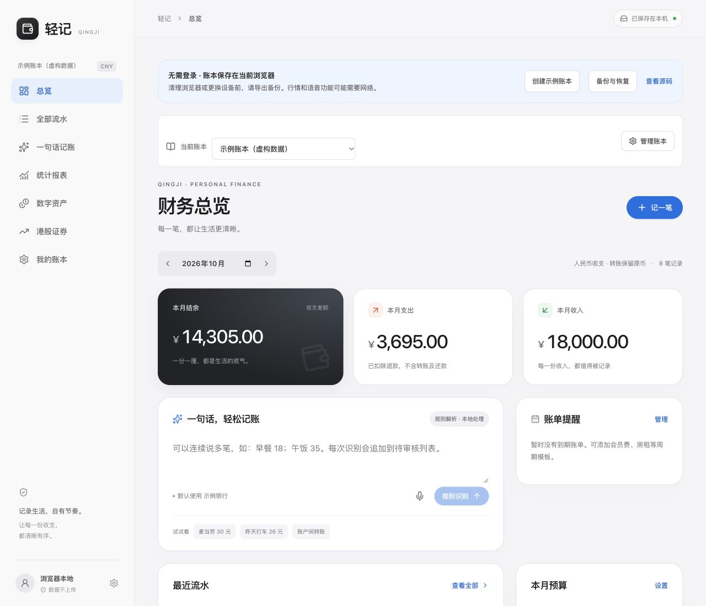

# 轻记 Qingji · 公开版

打开即用的个人账本。**无需登录、无需服务器、无需配置密钥。**

- **在线使用：** [打开轻记](https://eason-xi.github.io/qingji-ledger-public/)
- **使用说明：** [三分钟上手](docs/USAGE.md)
- **部署自己的版本：** [GitHub Pages / 静态托管](docs/DEPLOYMENT.md)

> 账本数据保存在你当前浏览器的 IndexedDB 中，不上传到 GitHub 或本站服务器，不自动跨设备同步。请定期下载完整 JSON 备份；清理网站数据前先备份。



## 简单使用

1. 打开在线地址，直接使用“个人账本”，或者点“创建示例账本”体验虚构数据。示例不会覆盖你的个人账本。
2. 在“一句话记账”输入“午餐32元；打车18元”，识别后逐笔核对，再一键审核入账。
3. 在“我的账本 → 账户管理”修改账户名称、期初余额；需要时创建多个账本。
4. 在“我的账本 → 迁移与备份”下载完整备份，或从另一个浏览器恢复。

## 功能

- 多账本切换，每个账本独立保存账户、预算、流水、证券和数字资产。
- 手动、文字规则和浏览器语音输入；多批识别追加，逐笔核对后统一入账。
- 收支、关联退款、信用卡还款、手续费、标签、拆分、回收站及批量编辑。
- 银行人民币/港币独立余额、跨币种转账和银证转账。
- 港股账户现金、持仓、买入卖出、成本、股息和费用；只记录，不连接券商交易。
- 日/周/月/年报表、同进度比较、消费/退款/净支出、精确下钻及双币种资金流向。
- 预算、分类、支付渠道、周期模板和账单日历导出。
- CSV / XLS / XLSX 导入导出、JSON 备份恢复、最近20个本地版本快照。
- 数字资产手动余额与自选行情：自己添加/移除 BTC、ETH、USDT、BOX 或其他 CoinGecko 币种，显示 USD/CNY；接口不可用时保留手动参考价。
- 适配手机与桌面，首次完整加载后可缓存界面离线记账，支持添加到主屏幕。

## 本地启动

安装 **Node.js 24 LTS**，然后：

```bash
git clone https://github.com/Eason-Xi/qingji-ledger-public.git
cd qingji-ledger-public
npm ci
npm run dev
```

浏览器打开终端显示的本地地址，默认是 `http://127.0.0.1:5175`。

```bash
npm test       # 业务计算、存储和并发校验
npm run build # TypeScript 检查及静态构建
npm run preview
```

构建结果在 `dist/`。仓库自带 GitHub Actions，推送 main 后自动验证并发布 GitHub Pages。无需 Cloudflare、数据库、账户令牌或付费服务。

## 数据与隐私

- 保存操作只写当前浏览器的 IndexedDB，断网也可保存；数据库失败时会提示未保存，不静默丢弃编辑。
- 同一浏览器多标签页编辑使用原子版本校验，冲突时核对合并，避免覆盖。
- 每个账本保留最近20次成功保存的快照；历史与当前数据都在本机，不是云备份。
- 清空浏览器数据、无痕窗口关闭、更换设备或更换访问域名后，原数据不会自动出现。请用 JSON 备份迁移。
- IndexedDB 按网站来源隔离；自己部署时可使用独立域名。请在信任的设备上记录真实财务资料。
- 行情列表按账本保存，默认空白。添加后只向固定第三方行情接口发送所选币种 ID（BOX 另需 USDT 折算），不发送记账文字、账户名、余额或持仓。接口可用性受网络、限流和 CORS 影响。
- 浏览器语音识别可能依赖浏览器厂商的在线服务。公开版不提供云端 AI，也不接收或保存 API 密钥。

本仓库不包含私人版的数据库、账单、账户凭据、部署配置或 Git 历史。

## 技术与许可

React + TypeScript + Vite，财务数据保存在 IndexedDB。金额按整数分记录，数字资产数量使用精确小数计算。

本仓库暂未指定额外的代码许可证；第三方依赖分别遵循各自许可证，参见 [依赖说明](THIRD_PARTY_NOTICES.md)。
